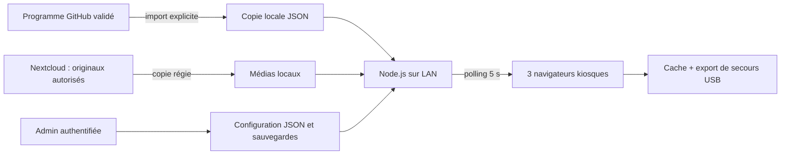

# Affichage dynamique B-Only’26

**État : PRÊT À RELIRE — prototype local, essais sur matériel à réaliser.**
Suivi : [#230](https://github.com/Alpinechain/Alpinechain_Association/issues/230).

Projet : B-Only. Objectif : afficher le programme des salles et une boucle hall,
puis permettre à la régie de corriger l'affichage pendant l'événement.
Public : participants et équipe technique. Sortie : application LAN autonome.
Validation : Cyrille / organisation avant diffusion des contenus et installation.
Code et démonstrations synthétiques : [licence MIT](LICENSE) ; les contenus
du programme et médias tiers conservent leurs droits propres.

## Démarrer et démontrer

Prérequis : Node.js 22 ou supérieur ; aucun paquet npm ni service SaaS.
`ffmpeg` est facultatif, utilisé uniquement pour créer une vidéo synthétique.
Les fichiers de travail et médias restent hors du dépôt.

```bash
cd projects/b-only/signage
# Choisir un dossier privé hors dépôt, sur le PC de régie.
export SIGNAGE_DATA_DIR="$HOME/.local/share/bonly-signage"
# Saisie masquée ; ne pas mettre le mot de passe dans une commande ou GitHub.
read -r -s -p 'Mot de passe régie (16 caractères minimum) : ' SIGNAGE_ADMIN_PASSWORD
export SIGNAGE_ADMIN_PASSWORD
export SIGNAGE_DEMO=1
bash make-demo-video.sh
npm start
```

Ouvrir trois onglets pour vérifier les grilles simultanées :

- [Salle A · samedi 15 h 10](http://127.0.0.1:8787/screen/salle-a?at=2026-11-07T15:10:00%2B01:00)
- [Salle B · samedi 15 h 10](http://127.0.0.1:8787/screen/salle-b?at=2026-11-07T15:10:00%2B01:00)
- [Hall](http://127.0.0.1:8787/screen/hall?at=2026-11-07T15:10:00%2B01:00)
- [Administration en démonstration](http://127.0.0.1:8787/admin?at=2026-11-07T15:10:00%2B01:00) : utilisateur `admin`, mot de passe saisi.

La simulation est réservée à `SIGNAGE_DEMO=1`, signalée à l'écran, et avance
avec le temps. Le paramètre `at` exige un fuseau explicite. En exploitation,
retirer `SIGNAGE_DEMO` et les paramètres d'URL. Les annonces et sélections
manuelles ont une expiration : utiliser la même simulation dans l'admin pour
les essayer avec une date future (voir lien et procédure jour J).

La boucle par défaut contient une annonce, une illustration, un logo fictif,
la vidéo test et l'agenda. Aucune identité fictive n'est présentée comme un
partenaire ou un intervenant réel. Elle valide la mécanique ; elle ne remplit
pas le critère de recette des médias réels approuvés. La vidéo absente ou
illisible déclenche un repli, puis est réessayée après une minute.

## Choix du lot 0 et architecture

Le prototype tient dans `projects/b-only/signage/` : programme et registres
sont déjà dans ce dépôt, avec une Issue pilote. Le périmètre reste isolé ;
le workflow GitHub Pages du programme ne publie pas ce dossier. Un dépôt
applicatif distinct pourra être proposé si l'outil devient un produit autonome.



Une page statique suffit à l'affichage et au secours. Le petit serveur ajoute
authentification, écritures atomiques, correction à distance et contacts des
lecteurs. Une plateforme d'affichage plus lourde n'est pas nécessaire à ce MVP.

Le premier lancement importe uniquement les 30 créneaux `public` et
`confirmed` / `fixed`. Notes, entrées internes et annulées sont exclues.
Le fuseau est `Europe/Paris` ; l'heure est recalée sur le serveur toutes les
5 secondes et progresse avec l'horloge monotone du navigateur. Bornes de
session : début inclus, fin exclue. Pauses, avant ouverture et fins de journée
sont explicites. Les chevauchements sont refusés à l'import. Aucun horaire ou
titre n'est déduit de l'identifiant d'une session.

### Vignettes « En cours » et « À suivre »

Les deux cartes affichent leur visuel en conservant ses proportions. La
correspondance reprend les identifiants et les copies de diffusion référencées
dans `programme/public/visuals.mjs`. Aucun portrait, titre ou rattachement n'est
inventé. Les pictogrammes sont conservés pour les pauses et créneaux concernés.

Avant installation, préparer les copies publiques encore hébergées sur le
site AlpineChain, puis démarrer ou redémarrer le serveur :

```bash
node prepare-session-visuals.mjs
```

La commande récupère uniquement les images du registre publié, sur
`https://alpinechain.xyz/wp-content/uploads/`, sans redirection ni écrasement.
Les copies sont conservées dans `SIGNAGE_DATA_DIR/visuals/`, hors GitHub.
Les autres visuels sont servis depuis les copies légères déjà présentes dans
le programme. Les 30 créneaux actifs disposent d'un visuel après préparation.
L'application ne charge aucune image sur Internet pendant la diffusion.
Le cache et l'export de secours incluent ces images. Une image absente laisse
le texte lisible ; les droits et la diffusion sur écrans restent à valider.

```bash
# Après une nouvelle validation officielle, import explicite puis redémarrage.
npm run import
# Ou : node import-programme.mjs /chemin/vers/programme-valide.json
```

La grille importée est figée dans `SIGNAGE_DATA_DIR/programme.json`, avec le
SHA-256 de sa source. Refaire les essais après chaque réimport. La grille de
référence et les registres ne sont jamais modifiés par le serveur.

## Configuration JSON et médias

`config.mjs` définit le contrat et `validateConfig` valide chaque écriture.
L'API publique contient uniquement la grille filtrée et les réglages affichés.
La configuration persistée ne contient aucun secret.

| Champ | Contrat |
|---|---|
| `version` | `1` |
| `screens` | Exactement `salle-a`, `salle-b`, `hall` |
| Écran | `label`, `scenario` (`room` / `hall`), `room` existante, `delayMinutes` entier −180…180, `manual` ou `null` |
| `manual` | `entryId` de la même salle et `expiresAt` ISO UTC ; retour automatique à expiration |
| `hall` | `paused`, `onlineEnabled` booléens, `agendaEvery` entier 0…20 (0 désactive l'insertion) |
| `announcement` | `null` ou `text` (240 caractères) et `expiresAt` ISO UTC |
| `playlist` | Tableau ordonné, 100 entrées au maximum |
| Diapositive | `id` unique, `type`, `title`, `durationSeconds` entier 3…3600, `enabled`, `approved` |
| Texte | `type: text`, `text` (500 caractères au maximum) |
| Image / vidéo | `src: /media/nom-versionne.ext`, `fit: contain` / `cover` ; vidéo : `muted` booléen |
| Vimeo en ligne | `type: vimeo`, `sourceUrl` égal à l'un des deux liens Paymium reçus, `muted` booléen ; exige `hall.onlineEnabled` |
| Agenda | `type: agenda` ; grilles immédiates de chaque salle |

Seules les entrées `enabled: true` **et** `approved: true` tournent. Pour les
médias réels, faire valider les droits, le contenu et l'ordre avant d'activer
ces deux champs. L'approbation des seules démonstrations est technique.
La régie peut faire un aperçu sans diffusion depuis `/admin`. La durée réelle
d'une vidéo prime sur la durée de sa diapositive ; un blocage de lecture ou un
échec d'autoplay déclenche le repli. Le son est coupé par défaut ; son activation
nécessite un essai du navigateur et du matériel, sans désactiver ses protections.

Copier les médias autorisés dans `SIGNAGE_MEDIA_DIR` (par défaut
`SIGNAGE_DATA_DIR/media`). Employer des noms ASCII versionnés et ne pas
remplacer un fichier déjà diffusé sous le même nom : les lecteurs le mettent
en cache. Extensions : MP4/WebM, PNG/JPEG/WebP/GIF. Pas de fichiers lourds dans
GitHub, pas de téléchargement depuis un lien tiers par l'application.

### Paymium en ligne dès le prototype

Les deux liens fournis sont intégrés dans l'administration : **Prévisualiser
B2B/B2C en ligne** ouvre le lecteur officiel, sans téléchargement. Les
identifiants des liens non répertoriés sont conservés dans le paramètre `h`.
B2B figure avant B2C dans les entrées préparées. En mode démonstration, les
boutons **Essayer B2B/B2C dans le hall** activent un essai en tête de boucle,
signalé comme démonstration ; cela ne valide pas les droits de diffusion de
l'événement. En exploitation, activer le mode en ligne et approuver les
entrées seulement après validation humaine.

Le lecteur demande l'autoplay muet et respecte les restrictions du navigateur
et de Vimeo. Événements `ended`, durée, erreurs et progression pilotent la
rotation, avec repli après 12 secondes sans démarrage ou 15 secondes sans
progression. Une vidéo refusée est réessayée après une minute. Sans connexion,
ces entrées sont sautées ; l'export de secours les retire entièrement.
La vidéo locale de test, les salles et les autres diapositives continuent.
Les deux MP4 ont été fournis par Cyrille le 26 octobre. Deux entrées `video`
locales et leurs boutons d'aperçu sont également préparés. Les boutons d'essai
permettent de choisir le fichier local ou Vimeo pour une même variante, sans
diffuser deux fois cette variante. Le contenu de l'événement reste à valider.

Pour préparer des copies de lecture 1080p, avec audio conservé, sans remplacer
les originaux ni un fichier existant :

```bash
node prepare-paymium.mjs /chemin/b2b.mp4 /chemin/b2c.mp4
```

Les noms de sortie sont `paymium-b2b-v1-1080p.mp4` et
`paymium-b2c-v1-1080p.mp4`. Les originaux 4K restent dans Nextcloud ; les copies
de lecture restent dans le dossier média de la régie. Le catalogue donne les
tailles et SHA-256 des deux niveaux. Un essai en boucle et un essai hors ligne
ont été réalisés sur les copies ; cela ne vaut pas validation éditoriale.

Références de l'intégration : [paramètres Vimeo et liens non répertoriés](https://help.vimeo.com/hc/en-us/articles/12426486963857-How-to-add-autoplay-and-loop-parameters-to-my-video-s-embed-code),
[événements du lecteur](https://developer.vimeo.com/player/sdk/reference).

Exemple préparé, **désactivé jusqu'à validation** :

```json
{"id":"paymium-b2b-local","type":"video","title":"Paymium · B2B","src":"/media/paymium-b2b-v1-1080p.mp4","durationSeconds":98,"fit":"contain","muted":true,"enabled":false,"approved":false}
```

Le [catalogue de sources](catalogue-medias.json) conserve quatre entrées :
deux vidéos Néowalt déjà archivées et revérifiées par taille et SHA-256 le
26 octobre, et deux vidéos Paymium fournies sur le PC, avec leurs liens Vimeo.
Aucun doublon Néowalt n'a été créé et aucun téléchargement Vimeo n'a été fait.
La lecture des deux intégrations en ligne a été vérifiée, ainsi que la lecture
des copies locales sans réseau. Les droits de diffusion pendant l'événement
restent à confirmer. **B2B est prioritaire pour le quiz ; B2C est complémentaire.**
Le catalogue est un inventaire, pas une playlist activée.
Les deux originaux Paymium sont archivés sans écrasement et indexés dans
`06_Medias/Paymium/` : [B2B](https://cloud.alpinechain.xyz/f/5229),
[B2C](https://cloud.alpinechain.xyz/f/5230). Tailles et SHA-256 ont été relus
sur le serveur et correspondent aux originaux du PC ; indexation sans erreur.

## Cache, coupures et secours

L'onglet conserve la grille et la configuration dans `localStorage`. Après une
coupure, les calculs horaires continuent et le statut devient « Hors connexion ».
L'expiration d'une annonce ou sélection manuelle reste calculée localement.
Les images/vidéos approuvées sont copiées dans Cache Storage lorsque le contexte
du navigateur le permet ; leur lecture utilise une URL Blob, même hors réseau.
Précharger toute la boucle et vérifier le quota disque du lecteur.

**HTTP sur une adresse LAN ne permet pas Service Worker / Cache Storage dans
les navigateurs usuels.** Dans ce cas, seul l'onglet ouvert garde les données
et les médias déjà chargés en mémoire ; la lecture d'un média jamais chargé ou
la réouverture après coupure exige le serveur ou le secours. Pour la navigation
hors ligne complète, utiliser HTTPS avec un certificat approuvé sur chaque
lecteur (préparation réseau à valider) ou localhost. Le Service Worker cache
le shell des trois écrans, jamais l'admin ni les réponses API. Il est installé
au premier accès en ligne ; vérifier son installation avant la coupure.
Le navigateur peut évincer son cache : l'export USB reste le secours fiable.

```bash
npm run export -- /chemin/existant/secours-bonly-20261106
```

La commande refuse un dossier cible existant et copie les seuls médias
activés/approuvés. Les absences sont listées, avec fallback programme. Transférer
**tout le dossier** sur les lecteurs et une clé USB. Ouvrir `salle-a.html`,
`salle-b.html` ou `hall.html` directement avec Chromium, sans réseau ni Node.js.
L'export embarque le modèle, la grille et la configuration ; il conserve ses
médias à côté des HTML. Il n'a pas de pilotage distant. Régénérer après chaque
changement utile. Il dépend de l'horloge locale du lecteur au démarrage.

## Exploitation LAN et démarrage automatique

### Adresses demandées pour les écrans

| Adresse proposée | Affichage |
|---|---|
| `conference.b-only.org` | Salle principale, `/screen/salle-a` |
| `workshop.b-only.org` | Pleb Forum, `/screen/salle-b` |
| `accueil.b-only.org` | Hall, `/screen/hall` |
| `adminvideo.b-only.org` | Administration authentifiée, `/admin`, accès réseau privé |

Le routage est préparé dans [public-screen-hosts.json](deploy/public-screen-hosts.json).
L'activer sur la régie choisie avec `SIGNAGE_SCREEN_HOSTS_FILE` pointant vers
ce fichier. Chaque racine redirige vers son écran. Sur ces hôtes, le serveur
refuse l'administration et les écritures de configuration, même avec des
identifiants valides. Les contacts des lecteurs restent autorisés et bornés.
Un [exemple Caddy](deploy/Caddyfile.example) apporte une seconde protection
des routes privées. Il ne remplace pas la configuration d'infrastructure.

Pour l'administration, définir
`SIGNAGE_ADMIN_HOSTS=adminvideo.b-only.org`. La racine exige l'authentification
avant de rediriger vers `/admin`. Un même hôte ne peut pas être affecté à
l'administration et à un écran public. L'exemple Caddy refuse l'accès à cet
hôte hors loopback par défaut : remplacer cette liste uniquement par les
adresses ou le réseau VPN de régie validés lors de l'installation. Un simple
nom DNS ou mot de passe ne constitue pas un filtrage réseau. Référence :
[matcher réseau Caddy](https://caddyserver.com/docs/caddyfile/matchers#remote-ip).

Pour une publication Internet : préparer une PR dans `Alpinechain/Serveur`,
faire écouter Node sur `127.0.0.1`, utiliser Caddy pour HTTPS, puis faire
valider installation et entrées DNS OVH. L'administration se fera par accès
privé / tunnel SSH. Ces opérations ne sont pas effectuées par cette PR.
Le site Framer et les DNS actuels ne sont pas modifiés.

Pour l'événement : garder une régie maître unique. Un serveur public exige
Internet pour recevoir des corrections ; une régie sur LAN conserve cette
autonomie. Un DNS local peut réutiliser les mêmes noms, mais HTTPS et réseau
doivent être préparés sur les lecteurs. Deux instances LAN/VPS ne se
synchronisent pas automatiquement dans ce MVP : leur choix et la procédure
de bascule restent à valider. Le cache et l'export USB couvrent la continuité
de l'affichage ; ils ne fournissent pas une administration distante hors réseau.

Par défaut le serveur écoute uniquement `127.0.0.1:8787`. Pour un LAN dédié :
`HOST=0.0.0.0` et `SIGNAGE_ALLOWED_HOSTS=regie.local,192.168.50.10,localhost,127.0.0.1`.
L'énumération contient les noms/IP sans port. Les hôtes non prévus sont refusés.
Pas de redirection Internet ni d'exposition publique. Basic Auth protège
l'admin ; en HTTP, utiliser un LAN isolé de confiance, ou HTTPS pour chiffrer
les identifiants. Les requêtes de modification exigent JSON et une origine
identique ; l'authentification est temporisée après échecs répétés.
La liste des routes et noms de médias est fermée ; les sorties du dossier de
médias par lien symbolique et les traversées de chemin sont refusées.

Unité [systemd d'exemple](deploy/bonly-signage.service), à adapter sur une
**machine dédiée**, sans modification des serveurs existants. Préparer le
compte `bonly`, le checkout sous `/opt/bonly/`, Node.js et
`/etc/bonly-signage.env` (mode `0600`, administrateur propriétaire) contenant
`SIGNAGE_ADMIN_PASSWORD`, `HOST` et `SIGNAGE_ALLOWED_HOSTS` ; puis installer
l'unité et l'activer après validation. `StateDirectory` rend la configuration
persistante. Observer les journaux avec `journalctl -u bonly-signage` ; ils
n'incluent pas les mots de passe, les textes ou les corps de requête.
`/healthz` prouve une réponse de l'application, pas la supervision matérielle.

Sur chaque lecteur, adapter [kiosk.desktop.example](deploy/kiosk.desktop.example)
et le placer dans `~/.config/autostart/` après essai. Prévoir ouverture de session
automatique, veille et économiseur d'écran désactivés, reprise d'alimentation
dans le firmware si disponible, bonne entrée HDMI et URL propre. Ces réglages
dépendent du matériel et n'ont pas été appliqués par ce prototype.

Avant chaque journée : vérifier NTP et l'heure Europe/Paris sur régie et
lecteurs, ouvrir les trois URL, regarder un cycle complet, tester une annonce
courte, contrôler les expirations puis retirer les essais. Le décalage en
minutes affecte tous les créneaux de la salle liée à cet écran ; appliquer la
même correction aux autres écrans configurés sur cette salle si nécessaire.
Pour un retard ponctuel, sélectionner le créneau et une durée de maintien,
puis revenir en automatique. Pour arrêter le hall, cocher Pause et appliquer.
La reprise du service recharge les JSON persistés. Exporter la configuration
depuis l'admin avant une intervention ; restauration par fichier, avec copie
préalable automatique dans `backups/`. Garder une copie du programme local
et du dossier média avec les exports de configuration.

## Matériel et recette restante

| À confirmer avec l'organisation / Novotel | État |
|---|---|
| Nombre d'écrans, dimensions, résolution, orientation, emplacement | Non inventorié |
| Lecteurs, HDMI/adaptateurs, alimentation, reprise après coupure | À tester sur place |
| LAN dédié, isolement Wi-Fi, Ethernet, IP/nom local, HTTPS | À valider |
| Régie dédiée, espace local et clé USB de secours | À désigner / préparer |
| Portrait réel, logo autorisé, droits et son hall | Validation et essais restants ; fichiers Paymium reçus et testés |
| Responsable technique sur place et relais de secours | À désigner |

Contrôles reproductibles : `npm test`, `bash -n make-demo-video.sh`, puis
`git diff --check`. Les tests utilisent le programme réel, les transitions,
décalages/expirations, le fuseau, les refus de configuration, HTTP/auth/origine,
les plages vidéo, les chemins, la persistance et l'export sans écrasement.
La recette navigateur et ses limites sont consignées dans [RECETTE.md](RECETTE.md).
Le prototype ne remplace pas les essais sur téléviseurs et réseau réels.
Le workflow `Test B-Only Signage` relance ces contrôles sur Node.js 22 et 24
à chaque changement du prototype ou du programme JSON. Les essais navigateur
et Vimeo restent séparés, sans paquet ni accès Internet requis pour cette CI.

Ordre jour J : test sans Internet, coupure LAN/serveur, redémarrage de chaque
lecteur avec la bonne URL, reprise régie, décalage horaire simulé, vérification
portrait/paysage à distance de lecture, enfin validation des médias réels.
Ne déclarer aucun de ces essais réalisé sans preuve. Aucune fusion,
publication sociale ou installation de production n'est incluse dans la PR.
